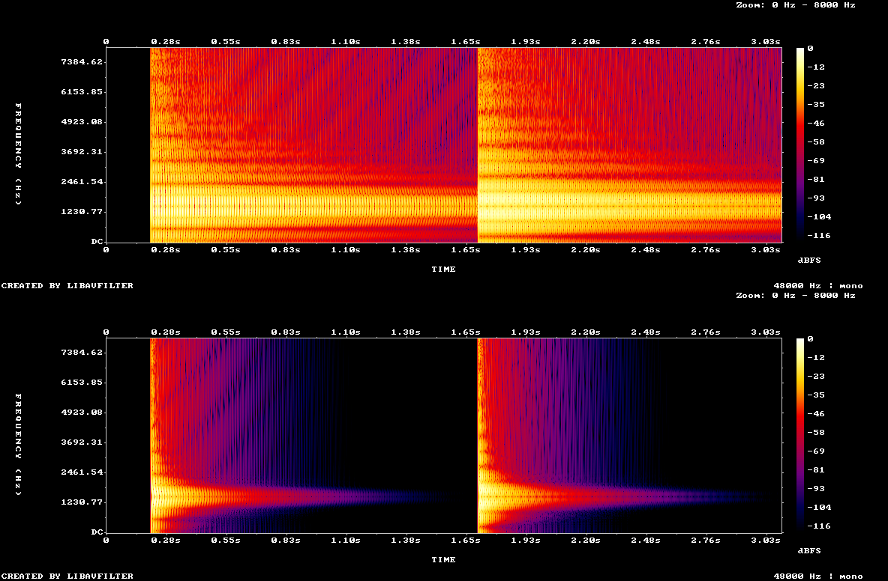

# Rubber Bridge

A zero-latency AU / VST3 plugin for macOS that makes any guitar sound like it
has a **rubber (or foam) bridge**: short, thumpy notes where the highs die
almost instantly and the fundamental survives as a soft "thunk". Works on
electric, acoustic and baritone, mono or stereo.

- **0 samples of latency**: built for live monitoring through the DAW.
- ~1.4 % of one CPU core (stereo, 48 kHz).
- Physically based: each pluck restarts an extra decay per frequency, with
  rates that add to the guitar's own losses, the way a lossy bridge works.



Listen (synthetic guitar, each file plays the unprocessed version, then the plugin):
[riff](docs/audio/electric_riff_before_after.mp3) ·
[acoustic strum](docs/audio/acoustic_strum_before_after.mp3) ·
[baritone](docs/audio/baritone_open_strings_before_after.mp3) ·
[fingerpicking](docs/audio/acoustic_fingerpick_before_after.mp3) ·
[ringing chord](docs/audio/electric_chord_ring_before_after.mp3)

## Settings

| Control | What it does |
|---|---|
| **Mute** | How hard the bridge damps the strings. 0 % = untouched. |
| **Damping** | How much faster the highs die than the lows. Higher = darker, more "thunk". |
| **Attack** | Pick snap. 50 % = physical. Lower = softer, darker plucks. Higher = holds each pluck open longer for more click. |
| **Thump** | Low-mid body knock on each pluck (up to +6 dB around 250 Hz). |
| **Retrigger** | How fully each pluck re-opens the *low* strings. High (default 80 %) for riffs and strumming; low (0–30 %) for fingerstyle with a melody over a ringing bass. |
| **Sensitivity** | Pluck detection. Raise it if soft re-picks get swallowed; lower it if a ringing chord "re-opens" by itself. |
| **Instrument** | Electric / Acoustic / Baritone: sets the band split and detector timing for the instrument's range. |
| **Mix** | Blend with the unmuted guitar (phase coherent). |
| **Output** | −24 to +12 dB. |

The **Muting per band** meter shows how much each band is currently being
damped. Every pluck should snap the bars back up, then they fall again.

## Building

Requirements: CMake ≥ 3.22, and on macOS Xcode (for the AU). JUCE 8.0.9 is
downloaded automatically.

```bash
# macOS: AU + VST3 + Standalone, universal binary
cmake -S . -B build -G Xcode -DCMAKE_OSX_ARCHITECTURES="arm64;x86_64"
cmake --build build --config Release

# install for your user
cp -R "build/RubberBridge_artefacts/Release/AU/Rubber Bridge.component" ~/Library/Audio/Plug-Ins/Components/
cp -R "build/RubberBridge_artefacts/Release/VST3/Rubber Bridge.vst3"   ~/Library/Audio/Plug-Ins/VST3/

# check the AU
auval -v aufx Rbg1 Rbbr
```

CI (`.github/workflows/build.yml`) builds the same thing on a macOS runner,
runs `auval`, and uploads a zip. If you install from that zip, macOS will
quarantine the unsigned download; clear it with
`xattr -dr com.apple.quarantine "<path to plugin>"`.

### DSP tests (any platform, no JUCE)

```bash
cmake -S . -B build-tools -DRB_BUILD_PLUGIN=OFF -DCMAKE_BUILD_TYPE=Release
cmake --build build-tools
ctest --test-dir build-tools --output-on-failure   # 895 checks
./build-tools/rb_eval                               # score vs. ideal rubber-bridge physics
./build-tools/rb_render in.wav out.wav --mute 0.6 --instrument baritone
```

## Layout

```
dsp/            DSP core (header only, no dependencies)
plugin/         JUCE wrapper and UI
tools/          offline renderer, synthetic guitar, evaluation, WAV I/O
tests/          DSP tests (physics-referenced)
docs/DESIGN.md  how it works, measured results, known trade-offs
```

## Calibrating with real recordings

The defaults come from physics and a synthetic guitar. Real before/after
recordings (for example with a string mute such as the Ernie Ball Noodle) will
tune them. See [docs/DESIGN.md](docs/DESIGN.md#calibrating-with-real-recordings)
for what to record.
